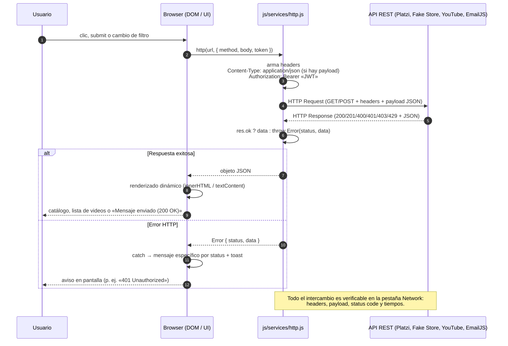
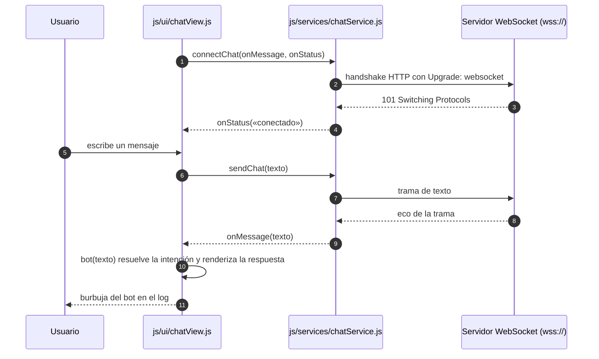

# Dashboard Integrador de Servicios Digitales

SPA (HTML + CSS + JavaScript vanilla, módulos ES) que actúa como cliente de 4 servicios en una sola página: **e-commerce**, **multimedia**, **correo electrónico** y **chatbot (WebSockets)**.

## Cómo correrlo

1. Clona el repositorio.
2. Crea tu archivo de configuración a partir del ejemplo (`js/config.js` **no** viene en el repo porque contiene claves):
   ```bash
   cp js/config.example.js js/config.js        # Linux / Mac / Git Bash
   copy js\config.example.js js\config.js      # Windows (CMD)
   ```
3. Abre `js/config.js` y reemplaza por tus credenciales:
   - `YOUTUBE_API_KEY`: en Google Cloud Console, habilita **YouTube Data API v3** y crea una API key.
   - `EMAILJS.service_id`, `EMAILJS.template_id` y `EMAILJS.user_id` (Public Key): se obtienen en el panel de [EmailJS](https://www.emailjs.com).
4. Sirve la carpeta con un servidor local (Live Server de VS Code, o `python -m http.server`). No funciona con doble clic por los módulos ES.
5. Plantilla de EmailJS: debe usar las variables `{{from_name}}`, `{{reply_to}}` y `{{message}}`, que coinciden con los `name` de los campos del formulario.

> **Claves protegidas** `js/config.js` está en `.gitignore`; el repo incluye `js/config.example.js` como plantilla.

## Cuadro comparativo de las APIs consumidas

| # | Sección del temario | API | URL base | Protocolo de capa de aplicación | Método HTTP | Formato de respuesta |
|---|---|---|---|---|---|---|
| 1 | Notificaciones y correo | EmailJS REST API | `https://api.emailjs.com/api/v1.0/email/send` | HTTPS · REST sobre HTTP/1.1 + TLS | `POST` | Petición `application/json`; respuesta `200` en texto plano (`OK`) y detalle JSON/texto en `400`/`401`/`429` |
| 2 | E-commerce (principal) | Platzi Fake Store | `https://api.escuelajs.co/api/v1` | HTTPS · REST | `POST /auth/login`, `GET /products?offset=0&limit=20` | JSON |
| 3 | E-commerce (respaldo) | Fake Store API | `https://fakestoreapi.com` | HTTPS · REST | `POST /auth/login`, `GET /products` | JSON (al momento de esta entrega responde `521` con HTML) |
| 4 | Multimedia (datos) | YouTube Data API v3 | `https://www.googleapis.com/youtube/v3` | HTTPS · REST | `GET /search`, `GET /videos` | JSON |
| 5 | Multimedia (reproductor) | YouTube IFrame Player API | `https://www.youtube.com/iframe_api` | HTTPS (carga de script) + `postMessage` con el iframe | `GET` (script) | JavaScript; el estado llega por el evento `onStateChange` |
| 6 | Otras tecnologías emergentes | WebSocket de eco (Postman) | `wss://ws.postman-echo.com/raw` | **WebSocket sobre TLS (RFC 6455)**: handshake HTTP con `Upgrade: websocket` y después tramas | `GET` + `Upgrade` | Tramas de texto (eco del servidor) |

## Diagrama de secuencia del flujo de datos

**Flujo REST (cliente → request/headers → API → JSON → DOM)**, idéntico para las secciones de correo, e-commerce y multimedia:



Mismo flujo en texto plano (por si el visor no renderiza Mermaid), con los cinco pasos que pide el reporte:

```
[1] Cliente (Browser)        El usuario hace clic, envía el formulario o cambia el filtro.
         │
         ▼
[2] HTTP Request / Headers   js/services/http.js arma la petición:
         │                      · GET | POST  <URL de la API>
         │                      · Content-Type: application/json        (cuando hay payload)
         │                      · Authorization: Bearer <JWT>           (e-commerce)
         │                      · payload JSON en el body               (POST)
         ▼
[3] Servicio API             EmailJS · Platzi · Fake Store · YouTube Data API
         │
         ▼
[4] JSON Response            HTTP 200 / 201 + JSON   (errores: 400 / 401 / 403 / 429 / 521 + detalle)
         │
         ▼
[5] Renders DOM              storeView · cartView · videoView · contactView · chatView
                             pintan el resultado (innerHTML / textContent) y la pestaña Network
                             deja ver headers, payload, status code y tiempos.
```

**Flujo WebSocket (chatbot en tiempo real)**:



Versión en texto plano del flujo del chat:

```
[1] Cliente (Browser)        El usuario escribe en el formulario del asistente.
         │  connectChat(onMessage, onStatus)
         ▼
[2] WebSocket handshake      chatService.js abre  new WebSocket("wss://…")
         │                   → petición HTTP con  Upgrade: websocket
         ▼
[3] Servicio WebSocket       101 Switching Protocols  →  onStatus("conectado")
         │  sendChat(texto) → trama de texto
         ▼
[4] Tramas de respuesta      onmessage(data)  →  onMessage(texto)  (eco del servidor)
         │
         ▼
[5] Renders DOM              bot(texto) resuelve la intención (envíos, pagos, devoluciones,
                             filtros, videos o carrito) y añade la burbuja al log del chat.
```

## Manejo de respuestas HTTP

| Código | Dónde aparece | Qué hace la app |
|---|---|---|
| 200 | Todas las APIs | Renderiza el resultado en el DOM (catálogo, lista de videos, «Mensaje enviado (200 OK)»). |
| 201 | `POST /auth/login` de Platzi | Guarda el JWT y el badge superior pasa a «🔒 JWT activo». |
| 400 | EmailJS (datos o plantilla inválidos), YouTube (petición o `key` inválida) | Muestra el mensaje en la UI, incluyendo el detalle que devuelve la API. |
| 401 | EmailJS (credenciales inválidas), Platzi (`login` con contraseña incorrecta) | Mensaje específico («Credenciales … inválidas (401)»). |
| 403 | YouTube (cuota agotada o key restringida) | Aviso (toast) para revisar la API key o la cuota. |
| 429 | EmailJS (demasiados envíos) | «Demasiados envíos seguidos (429). Espera un momento e intenta de nuevo». |
| 521 (5xx) | Fake Store API (servicio caído) | Se registra en consola; si falla el catálogo, la sección muestra «No se pudo cargar el catálogo». |
| Red caída / *timeout* | Cualquier API | `AbortSignal.timeout(8000)` corta las peticiones colgadas y el `catch` de la vista muestra el mensaje. |

Todas las llamadas usan `async/await` con `try/catch`. `http.js` registra en consola método, URL, status y tiempo de cada petición, y lanza un error con `status` y `data` cuando la respuesta no es exitosa.

## Metadatos multimedia que reporta la app

| Metadato | Origen real | Dónde se ve |
|---|---|---|
| Duración | `contentDetails.duration` en formato ISO-8601 (YouTube Data API v3) | Lista de videos de cada búsqueda |
| Vistas | `statistics.viewCount` (YouTube Data API v3) | Lista de videos |
| Estado del reproductor | Evento `onStateChange` de la IFrame Player API (sin iniciar, reproduciendo, en pausa, terminado, cargando, en cola) | Línea «Estado: …» bajo el reproductor |

> **Alcance real de la API:** la IFrame Player API de YouTube no publica el bitrate ni la resolución exacta de la pista (el reproductor negocia la calidad internamente), por eso esos dos metadatos no se reportan.

## Validación en la pestaña Network (Tech Demo)

| Qué revisar | Dónde en el Developer Tools | Qué debe verse |
|---|---|---|
| Petición de catálogo | Filtro `escuelajs` → `products?offset=0&limit=20` | `GET`, status `200`, Response con 20 objetos JSON |
| Token de autorización | `products` → Request Headers | `Authorization: Bearer eyJhbGciOi…` |
| Payload JSON | `auth/login` (o EmailJS) → pestaña Payload | `{"email":"john@mail.com","password":"changeme"}` |
| Encabezado de contenido | Request Headers de cualquier `POST` | `Content-Type: application/json` |
| Manejo de error | EmailJS con credenciales incorrectas | `400`/`401` y el detalle en la pestaña Response |
| Cuota de YouTube | `googleapis.com/youtube/v3/search` | `200` con `items`; `403` con `quotaExceeded`/`keyInvalid` |
| Tiempos de respuesta | Columna *Time* / pestaña *Timing* | Milisegundos por petición (también se imprimen en consola) |
| WebSocket | Filtro `WS` → `ws.postman-echo.com/raw` | `101 Switching Protocols` y en **Messages** la trama enviada y su eco |

## Arquitectura

```
index.html        → estructura de la página única
css/              → base (variables), layout (grid), components
js/main.js        → arranque y conexión de módulos
js/state.js       → estado compartido (token, productos, carrito)
js/config.example.js → plantilla de configuración (URLs y llaves)
js/services/      → comunicación con APIs
    http.js           cliente HTTP central (headers, token, status, log)
    storeService.js   Platzi / Fake Store: login JWT y catálogo
    youtubeService.js YouTube Data API: búsqueda, metadatos y caché
    emailService.js   EmailJS: envío de correo
    chatService.js    WebSocket
js/ui/            → renderizado del DOM
    storeView.js, cartView.js, videoView.js, contactView.js, chatView.js, dom.js
```

Los **servicios** solo hablan con las APIs; las **vistas** solo pintan el DOM; `main.js` los une. Así cada módulo se puede probar y cambiar sin tocar los demás.

## Notas técnicas

- **Multimedia:** el botón **▶ Videos** de cada producto busca un solo video relacionado (`maxResults=1`) y lo reproduce directamente. El chatbot, en cambio, puede mostrar una lista de 4 resultados. Se filtra con `videoEmbeddable=true` para que el video se pueda reproducir dentro de la página.
- **Reproductor:** se controla con la IFrame Player API y su evento `onStateChange` (sin iniciar, reproduciendo, en pausa, terminado, etc.). Los metadatos (duración y vistas) salen de `contentDetails` y `statistics`. YouTube no expone el bitrate ni la resolución exacta.
- **Cuota de YouTube:** cada búsqueda cuesta 100 unidades y la consulta de detalles 1 unidad, con un límite diario de 10,000. Por eso `youtubeService.js` guarda en caché las búsquedas repetidas.
- **Correo:** el navegador no puede enviar por SMTP, así que se usa la API REST de EmailJS con un payload JSON (`service_id`, `template_id`, `user_id` y `template_params`). El plan gratuito permite 200 envíos al mes.
- **Respaldo del catálogo:** si el login principal de Platzi falla, `storeService.js` intenta con el usuario de prueba de Fake Store API; al momento de esta entrega ese servicio responde `521`, así que la app avisa del error en pantalla.

## Seguridad

- El JWT de la tienda se manda en el header `Authorization: Bearer`.
- Las claves viven en `js/config.js`, que no se sube al repositorio.
- **Rotación pendiente:** el repositorio publica `js/dist/config.dev.js` y `js/dist/config.min.js` con la API key real de YouTube y las llaves de EmailJS, además de artefactos compilados que ningún HTML carga. Hay que **borrar esa carpeta `js/dist/`** y **revocar y regenerar** esas llaves en Google Cloud Console y en el panel de EmailJS (además quedan en el historial de git).
- En una app 100% frontend cualquier llave se puede ver en la pestaña Network. Por eso conviene **restringir la API key de YouTube** por referente HTTP (dominios permitidos) en Google Cloud Console. La Public Key de EmailJS está pensada para usarse en el navegador.
- Todo el tráfico va cifrado: HTTPS para las APIs REST y **WSS** para el chat (WebSocket sobre TLS).
